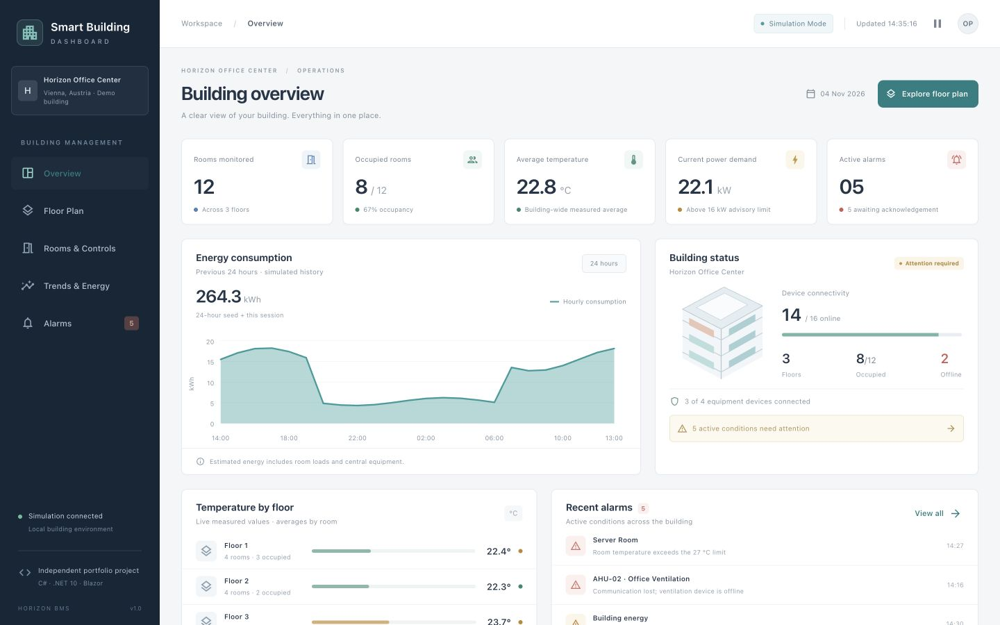
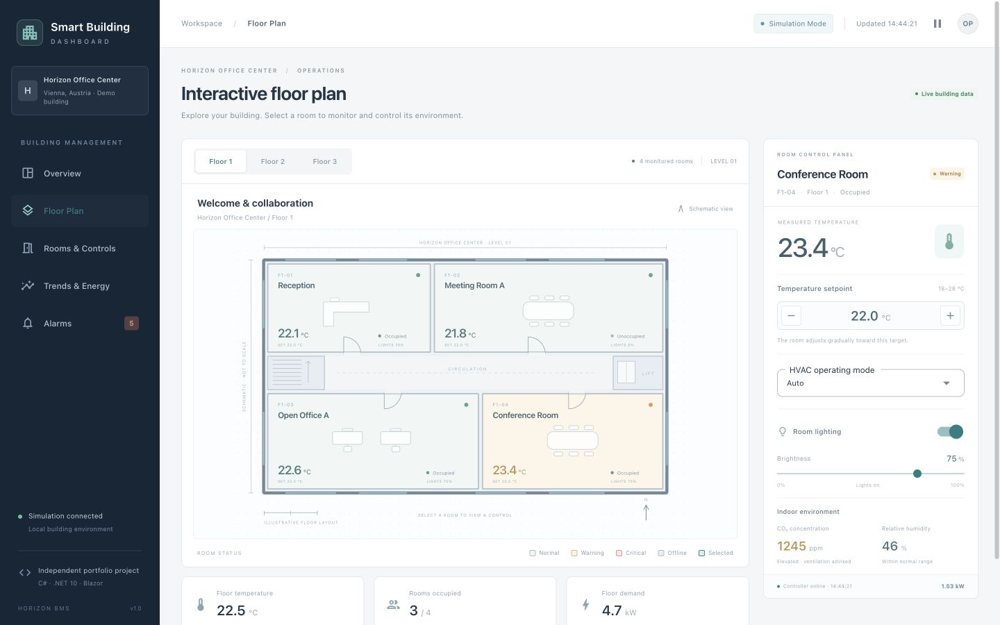
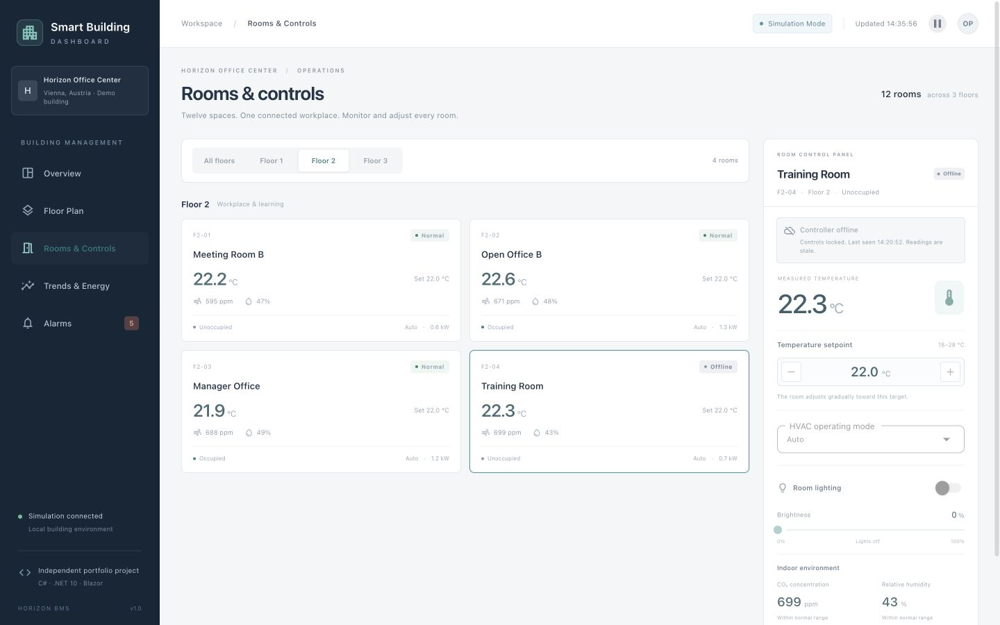
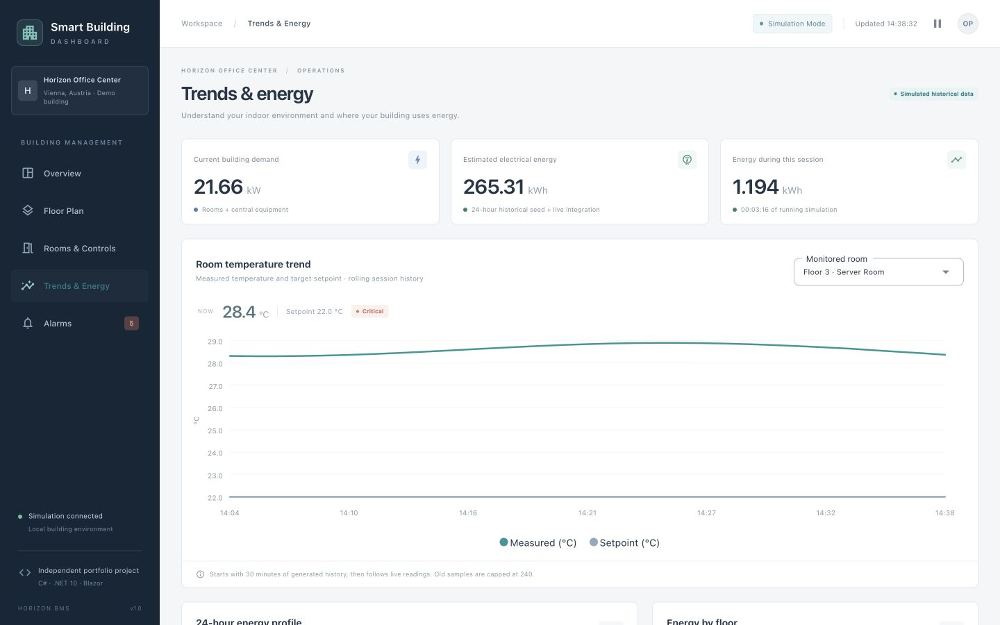
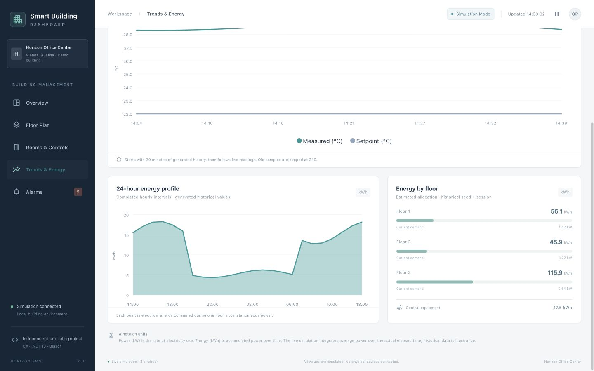
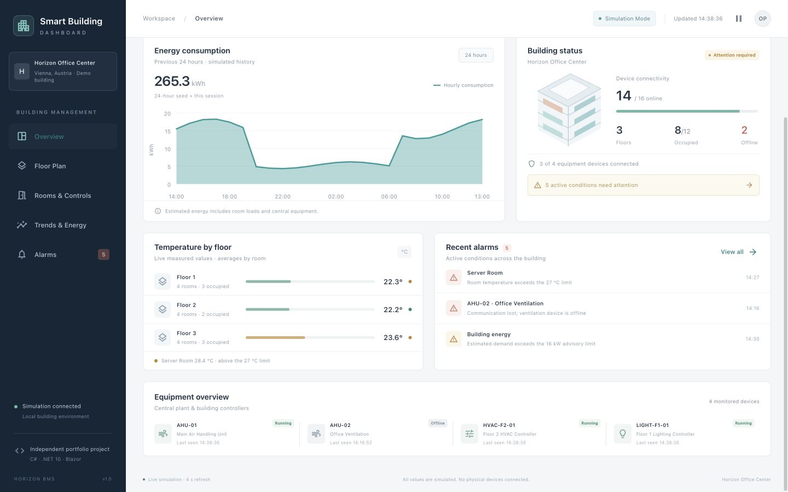
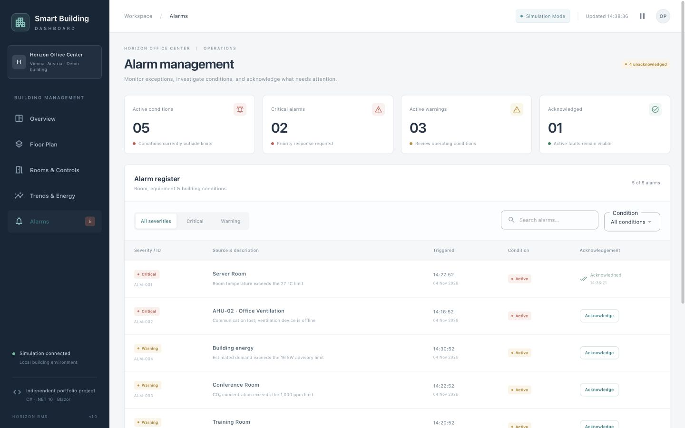

# Smart Building Dashboard

**An interactive building automation dashboard built with C#, .NET 10, Blazor, and MudBlazor.**

## About the project

I started working on **Smart Building Dashboard** to strengthen my Blazor and .NET development skills by building a practical, interactive application.

As a **.NET developer**, I'm interested in creating software that connects intuitive user interfaces with meaningful functionality. Building automation provides an interesting setting to explore how software can be used to monitor, visualise, and control complex systems.

The result is **Smart Building Dashboard**, an interactive Blazor application that simulates the operation of a fictional office building called **Horizon Office Center**, with three floors, twelve rooms, and four equipment devices.

The dashboard allows users to explore interactive floor plans, monitor room conditions, adjust HVAC and lighting settings, visualise temperature and energy trends, and manage building alarms.

This is a **learning and portfolio project**, not a production-ready building management system. My goal is to build functional, maintainable software, understand the decisions behind its design, and continue improving my skills through practical development.


> **Simulation Mode:** All building data and equipment behavior are simulated locally. No physical devices, external backend services, or building automation networks are connected.

## A look at the dashboard

I wanted the application to feel like a tool someone could actually explore, not just a collection of static charts. The screenshots below are from the running demo. The **interactive floor plan** is a particular highlight for me because it brings the room data and controls together visually.

### Dashboard overview

The landing page brings together the main building readings, occupancy, energy demand, equipment connectivity, and recent alarms.
The overview makes it easier to spot changes across floors and see which parts of the building may need attention.



### Interactive floor plan

Each floor has its own SVG layout. Selecting a room opens its details and gives you access to its controls without leaving the floor plan.



### Rooms and controls

Room settings can also be explored in a dedicated view. Changes made here are reflected in the other parts of the dashboard during the same session.



### Temperature trends

I wanted to make the difference between a **measured temperature** and a **requested setpoint** clear, including how both appear over time.



### Energy monitoring

The energy view explores the difference between the building's current power demand and energy consumed over time.



### Equipment monitoring

The dashboard includes a small set of fictional building devices, including an intentionally offline ventilation unit.



### Alarm management

The alarm register shows active and historical conditions, with filtering and acknowledgement controls.



*I plan to add a public live-demo link once the application is deployed. For now, the project can be run locally using the instructions below.*

## What you can explore

The application currently has five main pages. Each one gave me an opportunity to work with a different part of Blazor and the underlying building simulation.

| Page | What it does |
| --- | --- |
| **Overview** | Shows calculated building metrics, temperatures by floor, estimated energy usage, equipment connectivity, and recent alarms. |
| **Floor Plan** | Lets you switch between three floor layouts, select rooms, and open room controls directly from the SVG visualization. |
| **Rooms & Controls** | Lists all twelve rooms with floor filtering and reusable controls for temperature, HVAC, and lighting. |
| **Trends & Energy** | Shows simulated temperature history and setpoints, current power demand, and energy estimates by floor and over time. |
| **Alarms** | Lets you search and filter alarm conditions, review inactive alarms, and acknowledge alerts without automatically clearing the fault. |

The demo updates its simulated readings approximately **every four seconds**, with an option to pause and resume. Temperature setpoints range from **18–28 °C** in **0.5 °C** steps; HVAC modes include Off, Heating, Cooling, and Auto; and lighting supports an on/off switch and **0–100%** dimming. When a controller is offline, its controls are disabled rather than pretending a command can be delivered.

## What I'm also working on: SmartBuildingControlCenter (.NET Backend)

Alongside this dashboard, I'm developing a second project called **`SmartBuildingControlCenter`**, which focuses on the backend side of building automation software.

While **Smart Building Dashboard** explores the user interface, real-time visualization, and interactive controls using Blazor and MudBlazor, **SmartBuildingControlCenter** is where I'm expanding my understanding of backend development and application architecture.

Link: https://github.com/ivangeorgek/smart-building-control-center

The areas I'm exploring include:

- **ASP.NET Core Web APIs** for exposing building and equipment data.
- **PostgreSQL** for persistent storage of building information, sensor readings, and alarms.
- **Entity Framework Core** for database access and data modelling.
- **Backend architecture** for managing equipment, rooms, and building operations.
- **Real-time communication and building automation integration** as potential future improvements.

SmartBuildingControlCenter is **still under development**, and these are areas I'm working toward rather than features I'm claiming to have completed.

I'm keeping the projects separate for now so I can focus on understanding both sides of .NET development, from building an interactive operator interface to designing the services and data structures that could eventually support a more complete building management system.

## Getting started

I kept the setup intentionally simple so the project can be opened, built, and explored without configuring a database or external service.

You'll need the **[.NET 10 SDK](https://dotnet.microsoft.com/download/dotnet/10.0)**.

From the project directory, run:

```bash
dotnet restore
dotnet build
dotnet run --launch-profile http
```

The configured HTTP profile uses **http://localhost:5142**. If your terminal shows a different listening address, use that instead.

To run the HTTPS profile:

```bash
dotnet dev-certs https --trust
dotnet run --launch-profile https
```

The configured HTTPS profile uses **https://localhost:7018**. The development certificate trust command is intended for your local development machine.

### Running in JetBrains Rider

This project was developed and run on **macOS with Apple Silicon**, using **JetBrains Rider**.

1. Open `SmartBuildingDashboard.csproj` (or the project folder) in Rider.
2. Check that Rider is using the .NET 10 SDK and let NuGet restore complete.
3. Choose the `https` launch profile and click **Run** or **Debug**.
4. Open the application at the address shown in Rider's run output.

No database connection string, API key, or user account is needed to try the demo.

## If you want to try a few things

If you're exploring the application for the first time, this is the walkthrough I would suggest:

1. **Start on Overview** to see the building's current metrics, alarm count, and equipment state.
2. **Open Floor Plan**, choose Floor 1, and select **Reception**. Increase its setpoint by 0.5 °C and notice that the measured temperature doesn't jump to the new target.
3. **Try the room controls** by switching lighting on or off, changing brightness, and selecting an HVAC mode.
4. **Visit Rooms & Controls** and find Reception again. Its settings should still match. Select the **Training Room** to see how an offline controller is handled.
5. **Open Trends & Energy** to compare measured temperature with its setpoint and look at simulated electrical demand.
6. **Go to Alarms** and acknowledge the Server Room temperature alarm. The acknowledgement changes, but the underlying active condition remains.

These interactions are more useful than screenshots alone for showing what the Blazor application is doing.

## Technologies I'm using

| Area | Technology or approach |
| --- | --- |
| Language and runtime | **C#**, **.NET 10**, **ASP.NET Core** |
| Web UI | **Blazor Web App** with global Interactive Server rendering |
| Component library | **MudBlazor 9.12.0**
| Floor plans and charts | Razor-generated **SVG** and MudBlazor charts |
| Application state | **Scoped C# services**, in memory per Blazor circuit |
| Simulated updates | `PeriodicTimer`, cancellation, and renderer-dispatched updates |
| Styling | Custom CSS and a shared MudBlazor light theme |
| Data and infrastructure | In-memory simulation; no database or separate Web API |

I chose to keep this as a **single Blazor project**. For a learning-focused dashboard, that made it easier to follow the flow from a user interaction to a C# service and back to an updated component.

## How the application is organised

The code is divided into models, services, pages, and reusable UI components:

```text
Components/
  Layout/                   Navigation, header, and simulation startup
  Pages/                    Overview, FloorPlan, Rooms, Trends, Alarms
  Shared/                   Floor plan, room controls, charts, cards, badges
Models/                      Building, Floor, Room, Equipment, Alarm, SensorReading
Services/
  BuildingStateService.cs   Shared data, commands, validation, and alarms
  BuildingSimulationService.cs  Periodic sensor updates and cancellation
wwwroot/css/dashboard.css   Dashboard styling and responsive layout
docs/                        Screenshots and verification notes
```

### Three ideas I implemented 

**1. A sensor reading isn't the same as a command.** When someone changes a room's temperature setpoint, they're requesting a target. The sensor shouldn't immediately report that target as the current room temperature. The simulation instead moves the measured temperature gradually depending on the HVAC mode. This was an important distinction for making the controls feel credible.

**2. Different pages should reflect the same room state.** I wanted the floor plan, room directory, dashboard metrics, and alarms to agree with each other. `BuildingStateService` holds the current building data, validates control changes, and notifies interested components when something changes. Components schedule their renders through Blazor and clean up subscriptions when disposed. The mutable services are scoped to the current interactive circuit, so separate visitors don't unintentionally control the same demo session.

**3. Acknowledging an alarm isn't the same as fixing it.** In the alarm model, a condition can still be active even after an operator acknowledges it. The dashboard records acknowledgement separately from whether the fault has cleared. If a cleared condition triggers again, the acknowledgement can reset. I wanted that behavior to reflect the difference between *being aware of a problem* and *resolving the problem*.

### Simulated readings and engineering units

The simulation updates about every four seconds. Temperature responds gradually to the HVAC settings, while humidity and CO₂ change within controlled ranges. The history is bounded so the demo doesn't accumulate unlimited samples. Some conditions are deliberately abnormal so the alarm features can be demonstrated reliably.

| Value | Unit | What it represents |
| --- | --- | --- |
| Temperature / setpoint | °C | Measured condition / requested target |
| Relative humidity | % | Simulated indoor moisture level |
| CO₂ concentration | ppm | Simulated air-quality reading |
| Electrical power | kW | Estimated demand at a point in time |
| Electrical energy | kWh | Estimated consumption over a period |

Energy is estimated by accumulating power over elapsed time, rather than treating **kW** and **kWh** as interchangeable. The 24-hour energy chart includes generated historical values; it isn't based on real utility meters. An offline device's last known reading is retained, because loss of communication doesn't necessarily mean that the device has stopped consuming power.

## The fictional building

The demonstration uses **Horizon Office Center**, with four monitored rooms on each of its three floors:

| Floor | Rooms |
| --- | --- |
| **1** | Reception, Meeting Room A, Open Office A, Conference Room |
| **2** | Meeting Room B, Open Office B, Manager Office, Training Room |
| **3** | Meeting Room C, Open Office C, Server Room, Executive Office |


I included a few deliberate situations to make the application more interesting to explore: high Server Room temperature, elevated CO₂ in the Conference Room, an offline ventilation unit, a high-demand advisory, and an offline Training Room controller. Some of these are held in place as repeatable demo scenarios rather than being cleared automatically by the simulation.

## Testing and current limitations

I've kept a separate [verification report](docs/verification.md) documenting the build and application checks performed, along with a checklist of things that still need manual testing.

There are also deliberate limits to this version:

- **No real equipment is connected.** The rooms, sensors, energy figures, and floor-plan layouts are illustrative and simulated.
- **There is no persistent storage.** Room settings, telemetry, and acknowledgements live in memory for an interactive session; a fresh circuit or full reload starts again.
- **There is no authentication or operator audit trail.** This is a demonstration, not a secure industrial control application.
- **Some conditions are fixed for the demo.** Occupancy, equipment connectivity, and selected alarm scenarios are not fully dynamic.
- **Blazor Interactive Server needs a running server and browser connection.** It cannot be deployed as a static GitHub Pages site.
- **Testing is still evolving.** Broader browser compatibility, accessibility, and physical-device integration are outside the current scope.

I think it's important to be clear about these limitations, especially in a domain where reliable monitoring and control matter.

## Where I'd like to take it

For **Smart Building Dashboard**, my next priorities are to publish a live version, add automated tests around state changes and alarms, and improve accessibility and responsiveness. I'd also like to make more of the simulated operating conditions configurable.

In parallel, **`SmartBuildingControlCenter`** is my way of exploring what a more complete backend might involve: Web APIs, PostgreSQL persistence, Entity Framework Core, longer-term telemetry storage, and potentially scheduling and real-time integration. Those are **areas under development or planned**, not functionality already provided by this frontend demo.

The broader goal is to keep building my understanding of .NET software from both directions: what an operator sees and interacts with, and what services would be needed to support those interactions reliably.

## Inspiration and disclaimer

My interest in this area grew from the learning about LOYTEC, its services and from reading about its building-management products. These references helped me understand at least on the surface level the types of problems building-automation software addresses.

> **Disclaimer:** This is an independent educational portfolio project inspired by general building automation concepts. The interface, code, and SVG floor plans in this project are original to this educational demo
